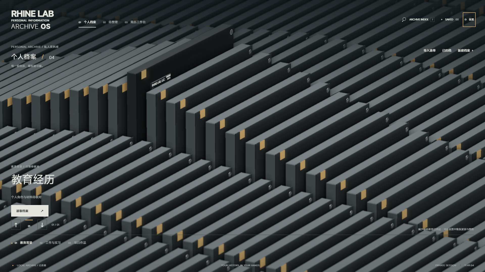

# Rhine Personal Archive · Rhine 个人档案终端

用本地材料整理经历、核对个人贡献，再制作可追溯的简历。界面保留 Rhine 原版玻璃档案阵列、波浪、惯性拖动、抽取与归位，业务采用原生 TypeScript、Three.js、Node.js 和 SQLite 实现。

这是供个人在自己电脑上使用的资料工具。材料、提取文字、确认记录和简历保存在本地；没有云端账号、团队任务分配或外部 AI 调用。岗位辅助选材只是本地关键词匹配，不能判断经历真伪或求职适配程度。

- [下载 v0.1.0](https://github.com/ReLuckyLucy/RhinePersonalArchive/releases/tag/v0.1.0)：源码 ZIP、Windows 便携 ZIP、校验文件。
- [完整使用与配置](docs/LOCAL-RUN.md) · [备份与恢复](docs/DATA-RECOVERY.md)
- [架构](docs/ARCHITECTURE.md) · [文件用途地图](docs/FILE-MAP.md) · [构建与发布](docs/RELEASING.md)
- [安全边界](SECURITY.md) · [更新记录](CHANGELOG.md) · [来源与许可](docs/SOURCE-ATTRIBUTION.md)



截图使用合成演示资料，发行包首次启动为空资料库。

## 可以做什么

- 从空库新建教育、工作、项目、荣誉、科研、志愿、作品及参考档案，或用 JSON 清单登记已有材料。
- 上传原件、记录指纹和版本；同一材料可关联多条来源与档案。
- 在本机提取 PDF、扫描件、图片、DOCX 和文本，校对识别结果，搜索档案、事实及正文。
- 区分本人贡献和团队成果，为事实关联页码、段落、摘录和证据等级；人工确认后才用于简历。
- 按岗位选择事实、编辑投递表述、保存不可变版本，导出 PDF 或可编辑 Word。
- 创建带口令的加密备份，验证并恢复到新目录，再明确切换资料库。

导入、文字识别与关键词匹配都不会自动确认个人事实。参考档案不能直接确认为个人经历。修订事实后需要重新确认；旧简历保留冻结时的文字与引用。

## Windows 便携版

1. 从 [Releases](https://github.com/ReLuckyLucy/RhinePersonalArchive/releases) 下载 Windows 便携 ZIP，解压到可写目录。
2. 双击 `启动档案.cmd`，浏览器打开 [http://127.0.0.1:4317](http://127.0.0.1:4317)。浏览器未打开时可手动访问该地址。
3. 使用结束后双击 `停止档案.cmd`。关闭浏览器标签页不会停止本机服务。

便携包包含 Node、应用依赖、OCR 语言数据和配套 Chromium，无需另装 Node 或安装依赖。首次启动创建空资料库。数据默认放在解压目录的 `runtime/`，请保留写入权限和足够空间。升级前备份资料，将新版解压到新目录，按[升级步骤](docs/LOCAL-RUN.md#升级)连接原库。

## 从源码运行

需要 **Node.js >=24.10.0 且 <25**、npm 和可写的本地目录。首次安装需要网络下载依赖和 Chromium；准备完成后日常资料处理在本机运行。

```sh
npm ci
npm run setup
npm run build
npm start
```

打开 [http://127.0.0.1:4317](http://127.0.0.1:4317)，停止时执行：

```sh
npm stop
```

`setup` 复制随锁定依赖提供的简体中文、英文 OCR 数据，并安装与 Playwright 匹配的 Chromium，用于 PDF 导出。Linux 缺少浏览器系统库时参见[本机说明](docs/LOCAL-RUN.md#从源码准备)。源码直接以 Node 运行服务器 TypeScript；`build` 执行类型检查并生成前端 `dist/`。

## Docker

项目提供 `Dockerfile` 与 `compose.yaml`，在项目根目录执行：

```sh
docker compose up --build -d
docker compose logs -f archive
```

访问 [http://127.0.0.1:4317](http://127.0.0.1:4317)。Compose 将端口只发布到宿主机回环地址，容器内监听 `0.0.0.0`。资料、备份和配置分别放在 `library`、`backups`、`config` 命名卷；OCR 和 Chromium 属于镜像资源。

```sh
docker compose stop
docker compose down
```

以上命令保留命名卷；`docker compose down -v` 会删除卷内数据。容器设置必须使用容器路径。“打开原件”不能启动宿主机桌面程序，请使用页面预览或下载。参见[容器配置与迁移](docs/LOCAL-RUN.md#docker-运行)。各项实测状态见 [PROJECT_STATE.md](PROJECT_STATE.md)。

## 第一次使用

1. **新建档案**：填写类型、名称、个人角色和已知日期；日期可只写年份，未知信息留空。保存后返回目录，选择卡片并点击“读取档案”。
2. **添加材料**：进入“证明材料”，上传证书、项目说明等文件，或保存一份本人陈述。界面显示原件可用状态与版本。
3. **提取与校对**：点击“提取文字”，完成后预览；有误时用“校对提取文字”。“待整理”也可批量启动提取。
4. **核对事实**：在“个人贡献”新增事实，选择本人贡献或团队成果，关联原件、具体位置、摘录与证据等级。保存后再点击“已核对来源，确认此事实”。
5. **制作简历**：进入“简历工作台”，选择已确认事实和个人信息字段；保存并预览，解决阻断提示，再“保存为版本”，导出 PDF 或 Word。
6. **创建备份**：设置 → 资料位置与备份，选择库外备份目录和自定口令，确认报告完整。先做一次恢复验证，再将其作为长期备份使用。

阵列支持拖动和惯性滑行；滚轮或上下方向键切档，左右方向键切分类。点击卡片后读取，Esc 返回；`/` 打开搜索，方向键选择、Enter 读取。设置中可开启减少动态效果。保留主场景完整交互，没有独立模型拆解查看器。

## 已有材料如何导入

导入不是启动前置条件。将清单和材料放进当前资料库，在“导入已有资料”填写清单相对路径，例如 `索引/catalog.json`。`archiveRel` 相对于**资料库根目录**，不相对于清单文件夹。

```json
{
  "records": [
    {
      "id": "sample-project-readme",
      "archiveRel": "材料/project-proof.txt",
      "subject": "示例项目",
      "category": "项目作品"
    }
  ]
}
```

可参考 [examples/catalog.json](examples/catalog.json)。试用时把它和 `project-proof.txt` 一起复制到空资料库根目录，输入 `catalog.json`。所有路径均须在库内。重复导入保留登记关系，变化原件生成新版本；导入后仍需人工整理与确认。详情见[导入格式](docs/LOCAL-RUN.md#json-清单导入)。

## 配置和数据位置

未配置时，路径相对于应用根目录：

| 内容 | 默认位置 |
| --- | --- |
| 资料库 | `runtime/library/` |
| 数据库、任务、简历导出 | 资料库内 `.rhine-archive/` |
| 上传原件与本人陈述 | 资料库内 `用户补充/` |
| 加密备份 | `runtime/backups/` |
| OCR 语言数据 | `runtime/ocr/` |
| 配套 Chromium | `runtime/browsers/` |
| 保存的配置 | `runtime/config.json` |
| 实例记录与服务日志 | 配置所在目录的 `instance.json`、`service.log` |

设置页面可修改资料库与备份目录。环境变量优先于保存配置，保存配置优先于默认值：

| 环境变量 | 用途 |
| --- | --- |
| `RHINE_CONFIG_FILE` | 配置 JSON 路径 |
| `RHINE_LIBRARY_ROOT` | 资料库目录 |
| `RHINE_BACKUP_DIRECTORY` | 库外备份目录 |
| `RHINE_ASSET_DIRECTORY` | OCR 资源目录 |
| `RHINE_BROWSER_DIRECTORY` | Chromium 资源目录 |
| `RHINE_PORT` | 监听端口，默认 `4317` |
| `RHINE_BIND_HOST` | 默认 `127.0.0.1`；容器使用 `0.0.0.0` |

完整配置和环境变量示例见[配置说明](docs/LOCAL-RUN.md#配置)。资料库不是浏览器缓存，清理缓存不会代替备份。默认资料库没有静态加密，加密只适用于显式创建的备份包。

## 支持范围和限制

| 材料 | 提取方式 |
| --- | --- |
| `txt`、`md`、`csv`、`json` | 按 UTF-8 读取文字 |
| `docx` | 提取原始文字，不还原复杂版式 |
| `pdf` | 提取页面文字，文字不足时转本地 OCR |
| `png`、`jpg`、`jpeg`、`webp`、`bmp`、`tif`、`tiff` | 简体中文与英文 OCR |
| 其他格式 | 保留原件；不支持自动提取 |

单次上传文件上限 512 MiB；自动提取上限 100 MiB、300 秒，PDF 最多 500 页，OCR 页面另有尺寸限制。手写、低清扫描、复杂表格和特殊排版需要人工核对。文字修订保存为独立结果，不改写原件。

PDF 导出需要配套 Chromium；Word 内容可编辑，不同办公软件可能重新分页，请分享前打开核对。目标一页或两页是排版目标，内容超量会提示，不会截断。真实性、身份、贡献及权利归属由使用者核对。已知依赖风险见 [SECURITY.md](SECURITY.md)。

## 开发

```sh
npm ci
npm run setup
npm run dev
```

开发模式由同一本机服务器挂载 Vite，使用同一套业务接口。指定独立库可避免日常材料被开发操作影响：

```powershell
$env:RHINE_LIBRARY_ROOT = "./runtime/dev-library"
$env:RHINE_BACKUP_DIRECTORY = "./runtime/dev-backups"
npm run dev
```

```sh
npm test
npm run test:e2e
npm run build
```

集成和浏览器测试使用隔离合成材料，验证软件行为，不认证个人材料。自动检查通过也不等于 Word 在所有办公软件上完成视觉验收。职责见[架构](docs/ARCHITECTURE.md)和[文件地图](docs/FILE-MAP.md)，打包见[发布说明](docs/RELEASING.md)。修改数据结构、确认状态或备份格式时，应补充相应行为回归测试。

## 许可与来源

项目代码采用 [MIT](LICENSE)。界面与场景源自 RhineLabUI，保留上游许可和署名；MiSans 等资源遵循各自许可。来源、适配范围、指纹与字体说明见 [SOURCE-ATTRIBUTION.md](docs/SOURCE-ATTRIBUTION.md)。反馈问题时请使用合成材料并移除身份信息。
