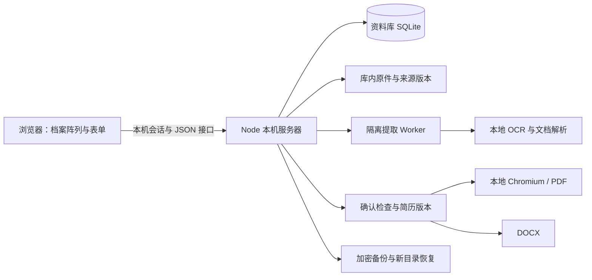

# 架构与数据规则

## 一套本机应用

浏览器负责原生 DOM 界面、Three.js 档案阵列和交互，本机 Node 服务器负责资料、SQLite、提取、导出与备份。Windows 便携版、源码和 Docker 共用同一套业务代码。没有云账号、外部 AI 服务、团队任务分配或协作后台。

前端 Vite 构建输出 `dist/`，Node 直接运行服务器 TypeScript。开发模式由同一服务器挂载 Vite；生产模式提供构建文件。Node SQLite 是内置依赖，固定 Node 24.x 运行时范围，不另启数据库服务。

## 领域对象

| 对象 | 责任 |
| --- | --- |
| Dossier / 档案 | 一段经历的类型、标题、日期精度、组织、角色、概述和类型字段 |
| Source / 材料 | 当前文件位置、指纹、版本、可用状态与提取状态 |
| Source version / 材料版本 | 冻结一次登记的材料内容指纹，事实明确引用某一版本 |
| Origin / 来源记录 | 清单中的来源身份，与按内容去重后的材料分开保存 |
| Extracted / 提取文字 | 原始结果、可校订正文、页/段结构和修订号 |
| Fact / 事实 | 本人或团队成果、文字、已证明字段、证据链接与确认状态 |
| Fact revision / 事实修订 | 事实每次改变的历史，包括确认、撤回和证据 |
| Resume draft / 简历草稿 | 已选事实及其修订号、投递表述、栏目和个人信息选择 |
| Resume version / 简历版本 | 当时文档、事实、来源与个人信息的不可变快照 |
| Export / 导出记录 | 对某版本生成 PDF/DOCX 的状态、文件指纹与页数提示 |

档案类别为教育、工作、项目、荣誉、科研、志愿、作品和参考。字段验证集中在 `shared/schemas.ts`，共享领域类型在 `shared/domain.ts`。未知日期保持未知，年份不会被伪造为完整日期。

## 从原件到可用事实

上传先写独立临时文件，再登记到资料库；清单导入只读取库内安全路径。文件内容使用 SHA-256，来源记录和文件实体分开；原件变化时创建新版本。清单主题与档案的持久映射保证档案改名、合并和归档后重复导入仍能找到归属，旧数据无法唯一判定时报告歧义。

提取在 Worker 中按队列运行，限定时间、大小和页数。支持文本、DOCX、PDF 和图片 OCR；失败保留原件。用户校订采用修订号检查；重新提取不能覆盖已经人工修改的正文。提取只是供阅读与检索的衍生内容，不代表来源真实或已经确认。

事实经历 `draft`、`review`、`confirmed`、`withdrawn` 状态。确认前检查证据位置、摘录、证据等级和原件指纹。参考档案不能直接确认成个人经历。事实被修改或合并归属后需重新核对；版本检查防止旧页面悄悄覆盖新改动。

## 简历生成

草稿选择已确认事实并保存修订号。构建文档时检查确认状态、事实修订、证明字段和投递表述新增内容；来源不可用或内容不再一致时阻止冻结。岗位提示是本地关键词匹配，不是模型调用或能力评分。

冻结生成独立版本；事实更新不会改写旧版本。PDF 与预览共用 `ResumeDocument` 和 HTML 打印模板，PDF 在临时回环服务中加载字体，Chromium 请求限制为本地导出来源。DOCX 从同一文档结构生成，编辑与分页表现由实际办公软件决定。导出先写临时文件，完成校验后改名，并记录指纹。

## 数据库、写入与恢复

库内 `.rhine-archive/library.sqlite` 保存业务记录，开启库时应用迁移。事务包住同步多表更新，异步文件/指纹工作通过库级写队列协调；不是远程多人并发数据库设计。长任务停止后按状态恢复队列。

备份先获取 SQLite 一致性快照，核对登记原件和成功导出，打包清单并加密。恢复在临时目录中解密，检查路径、大小、数据库和指纹，再复制到独占新目录；不覆盖当前库。只有验证标记通过才允许切换。细节见[备份与恢复](DATA-RECOVERY.md)。

## 视觉层与业务层

`src/rhine/` 保留原版场景、材质、光照、波浪、抽取、归位、惯性与渲染优化。`src/rhine/data.ts` 将实际非空分类和档案转换成场景数据，`src/features/archives/wave.ts` 连接业务选择、检索和正文。原件内容不作为模型或背景图片渲染。

DOM 页面负责可编辑内容、弹窗、键盘焦点和文本安全输出。保存数据通过 API，主题、声音、动效及上次页面等界面偏好可保存在浏览器；业务事实和简历不会只保存在浏览器。独立模型拆解查看器不在本项目范围。

## 本机信任边界

服务器默认只监听 `127.0.0.1`，检查 Host/Origin，使用本机会话 Cookie 和写请求 CSRF 令牌。Docker 仅在容器内监听所有网卡，宿主仍回环发布。此机制隔离网页来源，不提供用户账号、远程认证或文件解析的强安全沙箱。进程可以访问当前用户有权限的资料；默认数据库和原件不加密。详见 [SECURITY.md](../SECURITY.md)。

## 修改时从哪里开始

新增字段先修改共享 schema 和领域类型，再调整服务器仓储、表单和对应的确认/简历规则。涉及持久化时写增量迁移；涉及来源、事实和版本时补充行为回归测试。视觉变化应复核空库、单档案、多分类、快速输入、减少动态效果和资源释放。完整路径见[文件地图](FILE-MAP.md)。
